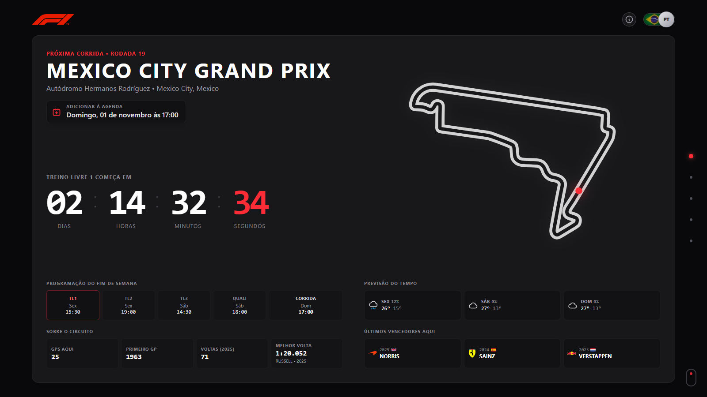
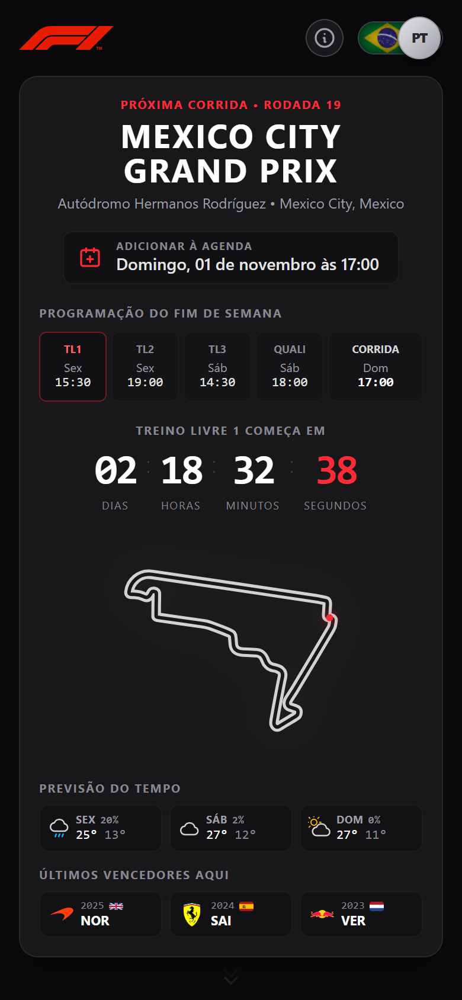
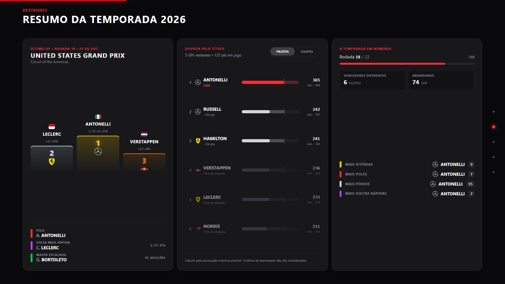
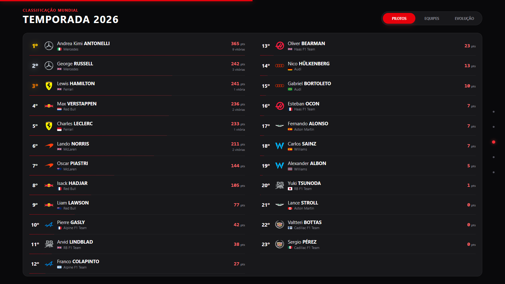
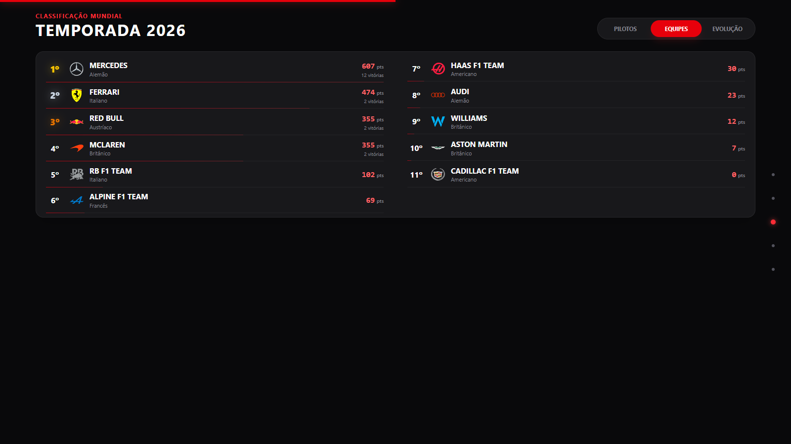
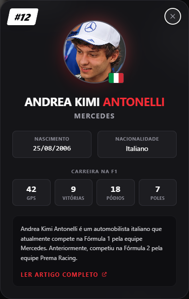
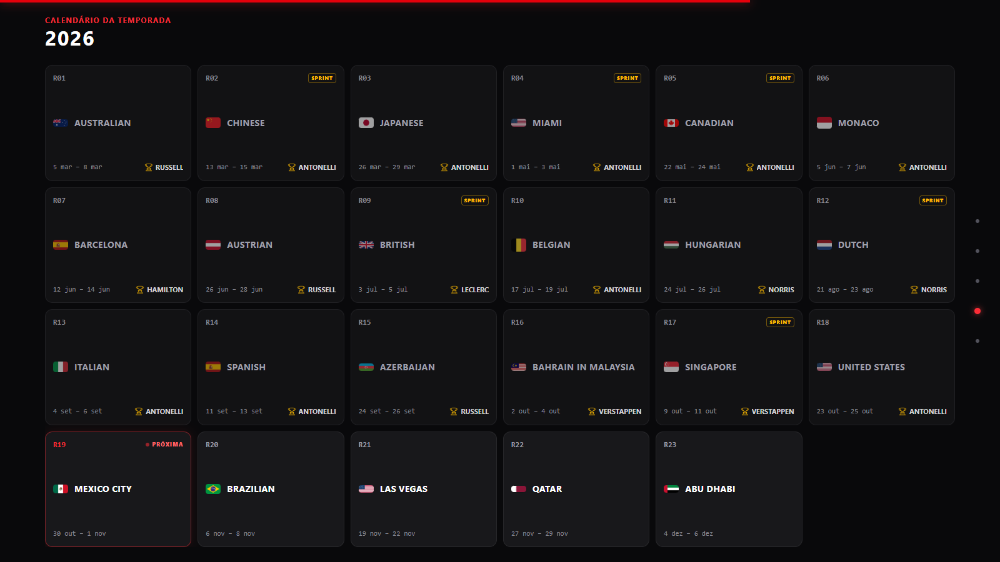
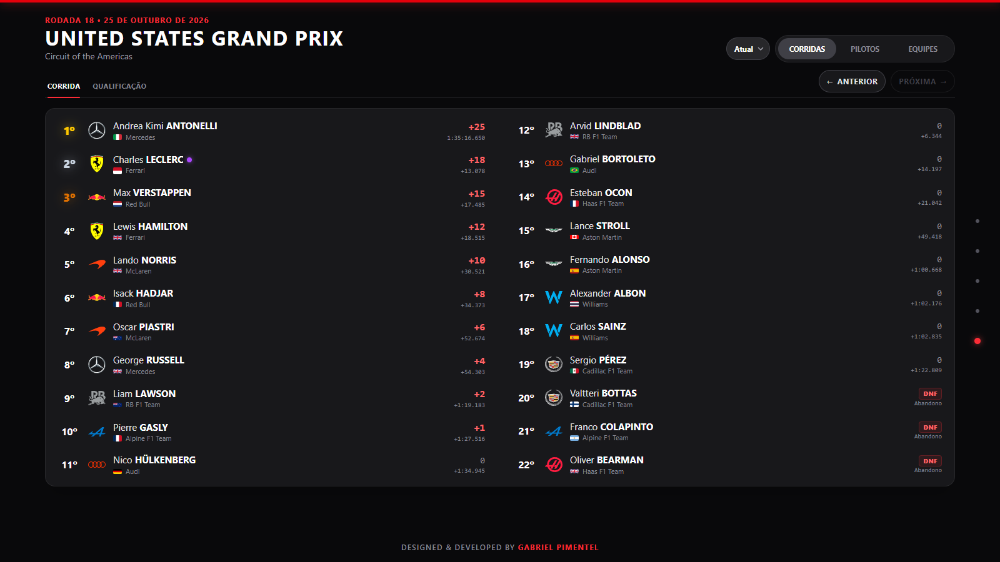

# 🏎️ F1 PRO Dashboard - Temporada Atual

[](https://nextjs.org/)
[](https://tailwindcss.com/)
[](https://www.typescriptlang.org/)
[](https://pages.cloudflare.com/)

Um painel interativo e responsivo para acompanhamento em tempo real da temporada de Fórmula 1. Desenvolvido com foco extremo em performance, acessibilidade e com uma estética dark inspirada em dashboards reais de telemetria das equipes.

🚀 **Acesse o projeto online:** [https://f1dash.pages.dev/](https://f1dash.pages.dev/)

---

## 🌟 Principais Features e Diferenciais

O projeto foi arquitetado para proporcionar uma experiência de **App Nativo** diretamente no navegador, utilizando conceitos avançados de UI/UX e React:

- 🚦 **Preloader Imersivo:** Animação de carregamento inicial simulando as 5 luzes vermelhas de largada da F1 (completa na primeira visita da sessão; nas seguintes, só um fade rápido).
- 🤖 **Zero Manutenção:** Tudo vem das APIs no momento em que a página abre — próxima corrida, resultados, classificação e calendário se atualizam sozinhos a cada etapa. Se surgir uma pista, equipe ou país novo sem imagem, o site mostra um substituto (traçado genérico, logo da F1, bandeira automática) em vez de quebrar.
- 📱 **Experiência "App-Like" (Scroll Snap):** Navegação vertical mandatória que trava a tela em seções específicas, garantindo aproveitamento total da tela (Screen Real Estate), ideal para mobile.
- 🌍 **Internacionalização Persistente (i18n):** Sistema de tradução instantânea e sem recarregamento (Context API). A interface alterna fluidamente entre Português e Inglês com transições de opacidade, detecta o idioma do navegador na primeira visita e salva a preferência do usuário no `localStorage`.
- 🛡️ **Resiliência e Tratamento de Erros:** Fallbacks de interface elegantes caso ocorram falhas de conexão ou timeouts nas APIs de dados, impedindo que o layout quebre.
- 🖥️ **Cabe em qualquer tela, sem rolagem interna:** cada seção ocupa exatamente a altura da tela. Testado em 15 tamanhos — de celulares de 360px a monitores 1440p, incluindo monitor na vertical, tablets e celular deitado — e também em 320px e com zoom de 200%, sem rolagem lateral nem texto cortado. Em telas largas as listas se dividem em duas colunas; no celular, os cards viram carrossel e só as listas longas (22 pilotos, 24 GPs) rolam.
- ✨ **Animações fluidas e discretas:** entrada em cascata na primeira vez que cada seção aparece, traçado da pista que se desenha, barras de pontos que "enchem" e pódio que sobe. Com a opção "reduzir movimento" do sistema ligada, tudo vira um simples esmaecer e o carro fica parado na largada.
- ♿ **Acessível:** dá para usar o site inteiro só com o teclado, com contorno de foco visível em cada botão; textos com contraste dentro do padrão WCAG AA; as janelas de detalhes fecham com Esc e devolvem o foco para onde você estava.

---

## 📸 Visão Geral das Seções

### 1. Próxima Corrida (Next Race)
O ponto de entrada do usuário. Traz informações críticas sobre o próximo evento do calendário, formatando a data e o horário automaticamente com base no fuso do usuário e no idioma selecionado.
- Contagem regressiva para a **próxima sessão** (TL1, Qualificação, Sprint, Corrida), com estado **AO VIVO** durante as sessões e "bandeira quadriculada" após a corrida. Assim que o fim de semana termina, passa sozinha para a próxima etapa.
- Programação completa do fim de semana, com sessões concluídas, ao vivo e a próxima destacadas.
- Previsão do tempo para os dias do GP (Open-Meteo) e os últimos vencedores no circuito — também no celular.
- **Sobre o circuito** (em telas com altura sobrando): GPs disputados ali, ano do primeiro GP, número de voltas e melhor volta da última edição.
- Layout dinâmico do traçado do circuito em formato SVG com animação de trajeto (com um traçado genérico caso o SVG ainda não exista).
- Fora de temporada: mostra os campeões e, quando o calendário seguinte sair, a contagem para a primeira corrida.

<div align="center">
   
   
</div>

### 2. Destaques (Highlights)
- **Pódio do último GP**, com pole, volta mais rápida e o piloto que mais ganhou posições.
- **Disputa pelo título:** calcula, com o calendário restante, quem ainda tem chance matemática de ser campeão (pilotos e equipes) e avisa quando o título está decidido.
- **A temporada em números:** vencedores diferentes, abandonos e quem lidera em vitórias, poles, pódios e voltas mais rápidas.
- No computador os três cards ficam lado a lado; no celular viram um carrossel.

<div align="center">
   
</div>

### 3. Classificação Mundial (Standings)
Uma visão completa e dividida da tabela de pontos atualizada, renderizada com animações suaves de fade-in.
- **Pilotos & Equipes:** Tabelas completas com cálculo de diferenças de pontos, logotipos oficiais e bandeiras.
- Em telas largas a lista se divide em duas colunas (1º–11º | 12º–22º) e cabe inteira na tela, com uma barra mostrando os pontos de cada um em relação ao líder.
- **Evolução dos pontos:** gráfico interativo rodada a rodada dos 6 primeiros (pilotos ou equipes).
- **Modal da equipe:** números da equipe na história e o **duelo interno** entre os companheiros (qualificação, corrida e pontos).
- **Wikipédia Dinâmica (Modal):** Ao clicar em um piloto, um modal interativo é aberto. Ele consome a API oficial da Wikipédia (buscando em `pt` ou `en` dinamicamente) para extrair foto e biografia (a partir do link exato do piloto informado pela própria API), além dos números da carreira (GPs, vitórias, pódios e poles).

<div align="center">
  
  <br><br>
  
  <br><br>
  
</div>

### 4. Calendário
- A temporada inteira em uma grade de cards (no celular, uma lista que já abre na próxima corrida), com datas, vencedor de cada GP já disputado e selo de fim de semana Sprint.
- Clicar numa etapa abre a programação completa, com os horários no fuso de quem está vendo.

<div align="center">
   
</div>

### 5. Resultados da Temporada (Last Races)
Um arquivo histórico navegável de todas as corridas que já ocorreram no ano.
- Navegação rápida entre as etapas usando botões e selects integrados.
- Abas de **Corrida, Sprint e Qualificação** (Q1, Q2, Q3 e diferença para a pole).
- Destaque visual automático para a "Volta Mais Rápida" (Purple Lap).
- **Detalhes de cada resultado:** ao clicar em um piloto, uma janela mostra posição de largada, posições ganhas/perdidas, tempo total, pontos e a melhor volta com velocidade média.

<div align="center">
   
</div>

---

## 🏗️ Arquitetura e Boas Práticas

Este projeto foi construído seguindo princípios de **Clean Code**:
- **Separação de Responsabilidades:** Funções lógicas de mapeamento (`f1-utils.ts`) isoladas dos componentes visuais.
- **Dicionário de Dados:** Textos abstraídos em `dictionaries.ts` para facilitar a escalabilidade de novos idiomas.
- **Tipagem Estrita:** Uso rigoroso de interfaces TypeScript (`types/f1.ts`) para garantir confiabilidade no consumo das APIs.
- **Otimização de Imagens:** Uso extensivo do componente `<Image>` do Next.js e atributos `loading="lazy"` para manter a nota máxima no Lighthouse (Performance e SEO).

---

## 🛠️ Tecnologias e Ferramentas

- **Core:** [Next.js](https://nextjs.org/) (App Router), [React](https://react.dev/), [TypeScript](https://www.typescriptlang.org/)
- **Estilização:** [Tailwind CSS](https://tailwindcss.com/)
- **Requisições:** `fetch` nativo com cache compartilhado entre as seções e novas tentativas automáticas (`src/lib/api.ts`)
- **Hospedagem:** [Cloudflare Pages](https://pages.cloudflare.com/)
- **Revisão visual:** as skills em `.claude/skills/` (de Emil Kowalski e Jakub Krehel, licença MIT) guiam o Claude Code na revisão de animações, acessibilidade, contraste e textos; os testes nos vários tamanhos de tela usam o Playwright MCP (configuração local em `.mcp.json`, fora do Git).

### 🔌 APIs Consumidas
- **[Ergast API (via Jolpi)](https://ergast.com/mrd/):** Fornece os dados brutos de calendários e classificações oficiais da FIA.
- **[Wikimedia REST API](https://www.mediawiki.org/wiki/API:REST_API):** Enriquecimento do modal dos pilotos com fotos e resumos biográficos.
- **[Flagcdn](https://flagcdn.com/):** Renderização ultrarrápida das bandeiras de nacionalidades.
- **[UI-Avatars](https://ui-avatars.com/):** Sistema de fallback (letras iniciais) caso o piloto não possua imagem pública na Wikipédia.
- **[Open-Meteo](https://open-meteo.com/):** Previsão do tempo do fim de semana de corrida (gratuita e sem chave).

---

## 🧰 Manutenção (opcional)

O site não depende de nenhuma tarefa agendada: ele busca tudo nas APIs quando a página abre. A única coisa que não vem da API são as imagens das pistas e os logos das equipes — e mesmo sem elas o site continua funcionando com substitutos.

Quando quiser conferir se falta alguma imagem (por exemplo, quando sair o calendário de uma nova temporada):

```bash
npm run check:assets   # lista pistas, logos, bandeiras e traduções que faltam
```

**Ao adicionar uma pista nova:** salve o SVG em `public/circuits/` com o nome exatamente igual ao `circuitId` da API (ex.: `albert_park.svg`, `madring.svg`). O comando acima mostra o id certo.

---

## 👤 Autor

**Gabriel Henrique Ferreira Pimentel**
- 🌐 [Portifólio](https://gabrielpimentel.pages.dev/)
- 💼 [LinkedIn](https://www.linkedin.com/in/gabrielhfpimentel/)